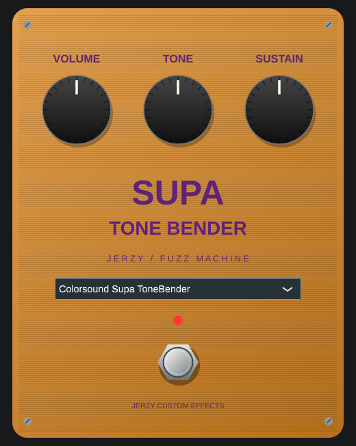

# Jerzy Muff Collection 0.2.0

VST3 fuzz collection with **13 schematic-based circuit revisions, 14 circuit modes and six legacy voicings**. New instances load Colorsound Supa ToneBender. The circuit engine solves connected transistor/diode networks, coupling capacitors, feedback, physical pot segments and the loaded tone stack.

**Accuracy status:** component values follow the supplied Kit Rae / BigMuffPage schematics, with explicit ambiguity notes. Device characteristics are nominal and uncalibrated. The numerical model passed 41 independent ngspice comparisons, but has not been matched against physical pedals. [Model assumptions and validation report](docs/ANALOG_MODEL.md).

## Download Windows VST3

[Download experimental 0.2.0 Win64 ZIP](https://github.com/jurekbak71-dev/JerzyBigMuffCollectionVST3/raw/refs/heads/main/downloads/JerzyMuffCollection-Win64-0.2.0.zip) · [SHA-256](downloads/JerzyMuffCollection-Win64-0.2.0.zip.sha256)

The ZIP contains the entire `.vst3` bundle, complete project/JUCE sources, build metadata and licence notices. Close the DAW, extract `Jerzy Muff Collection.vst3` into `C:\Program Files\Common Files\VST3`, then rescan effects. Native FL Studio compatibility remains unconfirmed. Full Windows pluginval GUI validation times out under Wine; Windows audio validation and CTest are reported separately in [VALIDATION.md](docs/VALIDATION.md).

## Guitar audio demos

[Listen to dry/wet guitar, all 14 circuits and six additional settings](audio-demos/0.2.0/README.md). Includes RMS-matched previews, a dry/Supa/Ram’s Head comparison and a downloadable WAV pack with original-gain float renders. [Audio test report](docs/AUDIO_TESTS.md).

## Models and controls

V1 66#5; Triangle 66#8, 66#6, 66#11; Jordan Creator 6000; V1 67#1; Ace Tone FM-3 Distortion/Boost; Triangle 72#1 and 72#2 PNP; Elk/Electro Sound Sustainar; Sekova Model 2015; Ram's Head 73#18; Colorsound Supa ToneBender. The six 0.1.0 approximations remain explicitly labelled Legacy. Existing states without a circuit parameter select the legacy engine, and the original six-choice automation parameter is retained. Oversampling behavior at high host rates has changed, so bit-identical old renders are not promised.

Volume, Tone, Sustain, model selection and bypass are automatable. Physical log/linear pot tapers follow each catalogue entry, subject to documented source ambiguities. Boost bypasses the Sustain network. Audio calibration is 1 full-scale sample = 1V peak with a 1k source and 1M load; use DAW pre-gain to match a known DI/hardware level. Circuit output can exceed 0dBFS; use Volume accordingly. There is no amp/cab simulation, preset browser or MIDI control.

GUI: full-size stompbox layout, three knobs, LED and footswitch. Model changes alter the panel; the Supa model uses an orange/purple panel. No original logo artwork is included. Model names identify the reference circuits without manufacturer affiliation.



## Build and tests

CMake 3.22+, C++17 compiler, Git, JUCE 7.0.12 (pinned commit, fetched automatically). Windows: Visual Studio 2022 C++ desktop workload. Linux:

```sh
sudo apt-get install libasound2-dev libx11-dev libxext-dev libxinerama-dev libxrandr-dev libxcursor-dev libfreetype-dev libfontconfig1-dev libxrender-dev libgl1-mesa-dev xvfb ngspice
cmake -S . -B build -DCMAKE_BUILD_TYPE=Release
cmake --build build --config Release --parallel 2
ctest --test-dir build -C Release --output-on-failure
```

Bundle: `build/JerzyMuff_artefacts/Release/VST3/Jerzy Muff Collection.vst3`.
The three CTest suites cover legacy DSP, processor/state/old-state migration and circuit numerics. To regenerate/check the component header: `python tools/generate_catalog.py` / `--check`.

Independent reference validation requires Python with NumPy and ngspice:

```sh
python tools/validate_spice.py --probe build/circuit_probe --ngspice /usr/bin/ngspice --output build/spice-validation
```

`tools/plot_validation.py` additionally needs Matplotlib. The processor test executable accepts `--benchmark`, or a PNG destination to render the default Supa editor. GitHub Actions builds native Windows/Linux, runs tests and full pluginval GUI validation, and packages artifacts. CI result must be checked separately; writing a workflow does not establish success.

## Cloud development and licence

`scripts/cloud-setup.sh` installs a rootless Debian/MinGW development toolchain under `/workspace` and runs validation. Its full Windows GUI check currently exposes the unresolved Wine timeout. The saved cloud install configuration uses explicitly labelled Windows audio-only validation; it does not claim the GUI check passed. Live Xvfb/Wine processes must restart after restoring a snapshot.

This project is GPL-3.0-only. JUCE is used under GPLv3; distribute the notices and corresponding source with binaries. See LICENSE and docs/JUCE-LICENSE.md.
