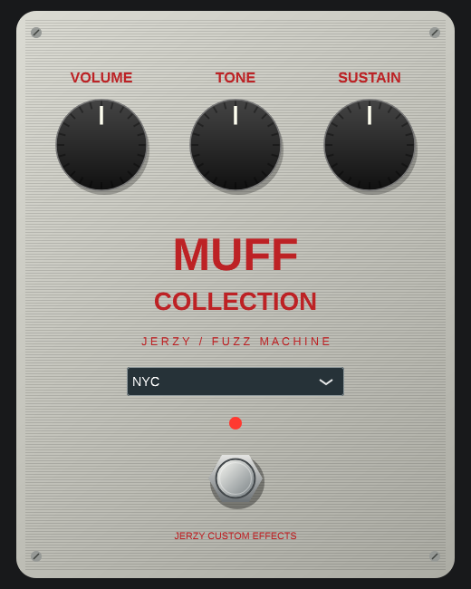

# Jerzy Muff Collection

Experimental JUCE 7 VST3 fuzz for mono/stereo guitar tracks. Six selectable voicings: Triangle, Ram's Head, Op-Amp, Civil War, Green Russian, NYC. Volume, Tone, Sustain and automatable bypass; 4x oversampling, parameter/model crossfades and DAW project-state recall.

The editor follows a full-size vintage stompbox layout with three large knobs, metal enclosure, LED and footswitch. No Pico layout or copied logos/assets. Model selection changes the panel colours.

**Sound status:** these are distinct phenomenological voicings using cascaded saturation and a scooped tone network. They are not verified circuit/component models or measured replicas of EHX revisions. In particular the Op-Amp voicing is not an actual op-amp circuit simulation. Hardware comparison and listening tests in FL Studio remain outstanding. Product/model names describe inspiration, with no EHX affiliation.



## Build

CMake 3.22+, C++17 compiler, Git and JUCE 7.0.12 (pinned commit; automatically fetched). Windows: Visual Studio 2022 C++ desktop workload. Linux dependencies:

```sh
sudo apt-get install libasound2-dev libx11-dev libxext-dev libxinerama-dev libxrandr-dev libxcursor-dev libfreetype-dev libfontconfig1-dev libxrender-dev libgl1-mesa-dev
cmake -S . -B build -DCMAKE_BUILD_TYPE=Release
cmake --build build --config Release --parallel 2
ctest --test-dir build -C Release --output-on-failure
```

VST3 bundle: `build/JerzyMuff_artefacts/Release/VST3/Jerzy Muff Collection.vst3`.
GitHub Actions builds and tests Windows/Linux on each main push and uploads platform-specific VST3 artifacts. CI status must be checked; creating a workflow alone does not establish success.

## Download Windows VST3 (experimental 0.1.0)

[Download the Win64 ZIP](https://github.com/jurekbak71-dev/JerzyBigMuffCollectionVST3/raw/refs/heads/main/downloads/JerzyMuffCollection-Win64-0.1.0.zip) · [SHA-256](downloads/JerzyMuffCollection-Win64-0.1.0.zip.sha256)

Built from source commit `16e667d`. Includes the complete VST3 folder, project and JUCE sources, and licence notices. Audio tests passed under Wine; full Windows GUI validation timed out under Wine, and native FL Studio compatibility is not confirmed. See [validation details](docs/VALIDATION.md).

## Windows installation

Close your DAW. Extract the entire **Windows** `.vst3` folder into `C:\Program Files\Common Files\VST3`, rescan effects in FL Studio, and load Jerzy Muff Collection on a mixer track. Start at low listening volume. Linux builds cannot be installed as Windows plugins.

## Development checks

`dsp_regression` covers 18 sample-rate/model combinations, finite bounded output, channel isolation, DC decay, reset and distinct voicings. `processor_state` covers state roundtrip and invalid state, oversampled processing, automation, bypass and channel isolation at three sample rates. Neither establishes hardware authenticity.

JUCE uses GPLv3 or its commercial licence. This project is distributed under GPL-3.0-only; see LICENSE. Bundles must be distributed with licence notices and corresponding source.

## Codex cloud

`scripts/cloud-setup.sh` prepares a rootless Debian development toolchain under `/workspace`, builds Linux and cross-compiles Win64 with MinGW, runs both CTest suites (Windows under Wine), and runs pluginval 1.0.4 at strictness 5. Linux GUI validation passed; full Windows pluginval currently times out in the Editor test under Wine. Windows audio-only validation and off-screen editor rendering passed. This timeout is unresolved; see docs/VALIDATION.md. Cross compilation uses JUCE 7.0.12 because JUCE 8 rejects MinGW. The Windows CI workflow additionally targets native MSVC; a local Wine result does not establish a native Windows/FL Studio result.
