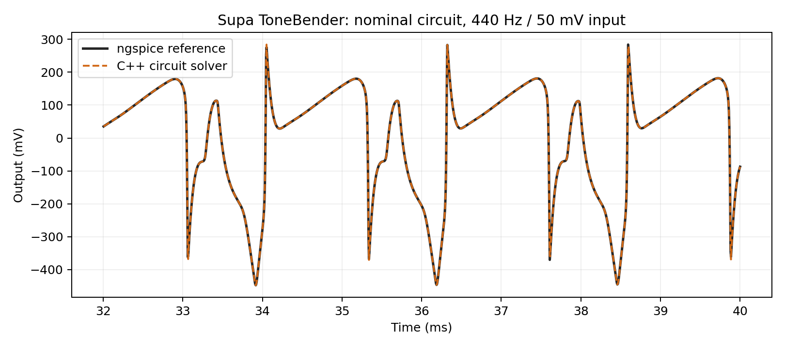
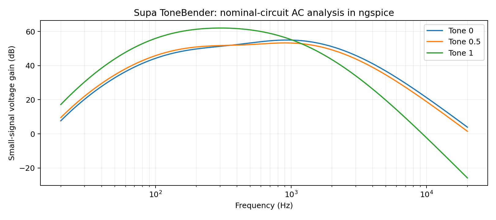

# Circuit models in 0.2.0

The new engine solves a connected transistor/diode circuit. The original six tanh voicings remain explicitly labelled Legacy; they are not claimed to model hardware circuits. New instances select Colorsound Supa ToneBender. A 0.1.0 state without the new `circuit` parameter selects Legacy mode, retaining the original `model` ID and six-choice automation range.

## Schematics and transcription

The canonical component catalogue is [circuits/revisions.json](../circuits/revisions.json), transcribed from the Kit Rae / BigMuffPage.com diagrams supplied by the user. Original artwork is not redistributed. Run `python tools/generate_catalog.py` after editing it; `--check` detects a stale generated C++ header.

| Circuit | Distinguishing implemented components/topology |
|---|---|
| V1 66#5 | 36k input; 39k input/second-clipping collectors; 120-ohm emitter resistors; 0.68/1uF coupling; 27k tone resistors |
| Triangle 66#8 | 3uF coupling and diode-branch capacitors; 33k collectors; 120-ohm emitters |
| Triangle 66#6 | 390k feedback; 150-ohm emitters; 22k tone; 0.1/1uF coupling |
| Triangle 66#11 | Missing C10; 15k collectors; mixed 100/150-ohm emitters; 0.12uF branches; logarithmic pots |
| Jordan Creator 6000 | 270k/220k feedback; 68k base resistors; 1k output collector; nominal 1N4001 junctions |
| V1 67#1 | Baseline R13/R11=15k; 100-ohm emitters; 820-ohm Sustain foot; 33k tone |
| Ace Tone FM-3 Distortion | 150k input collector; 3300pF across input resistor; 250pF feedback; extra 100k loading; volume before recovery stage |
| Ace Tone FM-3 Boost | Shared input and output stages, separate tone/volume path; both clipping stages bypassed; Sustain has no effect |
| Triangle 72#1 | 50nF diode branches; 150-ohm emitters; 12k clipping collectors |
| Triangle 72#2 PNP | Negative 9V rail and PNP device equations; 390k feedback; 560pF; 82/150-ohm emitters |
| Elk / Electro Sound Sustainar | PNP; 330pF tone high-pass capacitor; 100/150-ohm emitters; log pots |
| Sekova Model 2015 | 47nF diode branches; 150-ohm emitters; baseline 10k/12k collectors |
| Ram's Head 73#18 | 7.5k clipping inputs; 100-ohm emitters; 150nF coupling; 470pF; 3.3k output emitter |
| Colorsound Supa ToneBender | Entire first clipping-diode/coupling-cap branch absent; its 470pF feedback retained; second pair 1N4148; BC184-family nominal devices; 100nF pre-tone coupling; reversed tone branches as drawn; log pots |

Each array uses signal order: input Q4, clipping Q3, clipping Q2, recovery Q1. The JSON notes retain ambiguities: optional resistor variants are not averaged; ambiguous Supa `560k` annotation is not silently applied; FM-3 C15 uses the explicit lower-drawing 3300pF value; its conflicting tone-taper note is marked as an assumption. Sekova transistor captions conflict with symbol labels. Elk's original diode is unknown. Pot pin-to-clockwise mapping is an implementation convention and needs hardware confirmation, especially the reversed Supa tone network.

## Circuit equations

Resistors, capacitors, source impedance, potentiometer segments and output load form one global nodal system. Thus the following stage loads the preceding one, including the nonlinear input impedance of its transistor. The model is not a sequence of isolated waveshapers/EQ blocks.

For each BJT the model uses forward/reverse exponential junction currents, finite forward/reverse beta, and forward Early-effect base-width modulation. Nominal defaults are Is=1e-14 A, betaF=350, betaR=4, VAF=100 V, 27 C, plus explicit fixed 8pF base-emitter and 4pF base-collector capacitances. The listed hFE values of the 66#11 specimen are used as nominal per-stage beta estimates; without measurement current/temperature they are not a calibrated SPICE model. Other named transistor families currently share the nominal parameter set. Part labels alone do not determine their electrical characteristics.

Clipping pairs use antiparallel exponential diode junctions with their series coupling capacitors and nominal fixed junction capacitance. 1N914/1N4148 use Is=2.52nA, n=1.752; the uncalibrated 1N4001 approximation uses Is=5nA, n=2. These are declared nominal assumptions, not fitted measurements of the supplied pedals. There is no transistor high-current beta rolloff, diffusion storage, voltage-dependent junction capacitance or diode series resistance yet.

The simulation includes the physical 100k Sustain/Tone/Volume networks and finite 1-ohm pot endpoint resistance. Log pots use x^log2(10), giving 10% resistance fraction at half rotation; this is an assumed taper, not a measured track. For FM-3 the volume position and boost routing follow the alternate topology. No extra output gain compensation or limiter is applied to circuit models.

A 1k-ohm source and 1M-ohm output load define the reference conditions. One full-scale audio sample corresponds to one volt peak at the source. Match DI calibration with DAW pre-gain when comparing hardware: source impedance, actual volts, load and pot positions must all match. The plugin does not emulate guitar pickups, cable inductance/capacitance, an amplifier or speaker.

## Numerical implementation and real-time behavior

The processor initializes capacitor charges from a DC operating point using supply continuation. Transient integration is implicit trapezoidal, solved by damped Newton iterations. A banded linear solver avoids dense matrix work. A tested exponential polynomial differs from std::exp by less than 4e-10 relative error over the supported junction range. Rapid input changes trigger two/four smaller integration steps; Newton convergence failures are counted and tested, rather than silently labelled successful.

Oversampling is 4x at 44.1/48kHz, 2x at 88.2/96kHz, and 1x from 176.4kHz. Typical internal rates are therefore 176.4/192kHz, with extra local integration steps for fast excursions. The oversampling filter latency is reported to the host. This is not a guarantee of alias-free output at every drive/input condition.

Only selected/fading models are processed. All models' DC states and buffers are allocated during prepareToPlay. Independent stereo channels retain separate states; exact dual-mono input can share computation only while both channel histories remain aligned. Model/control smoothing is 20ms; bypass smoothing is 10ms and retains oversampling. Inactive circuits retain their last state, so model switching is not equivalent to continuously running thirteen physical pedals in parallel.

Measured full Supa processor cost in this 4-vCPU cloud container at 48kHz / 256 samples / approximately 0.5s audio: about 0.315 real-time ratio for dual mono and 0.664 for independent stereo, including oversampling. These are moderate-level sine benchmarks, not a worst-case CPU guarantee. Strong high-frequency signals, adaptive integration and overlapping model changes cost more; native Windows performance is unmeasured.

## Validation versus analog authenticity

The independent ngspice numerical solver was given the exported component graph and the same nominal device equations. Across 41 transient cases, all passed a 2.5% waveform NRMSE limit (or 2uV absolute error for vanishing output); worst NRMSE was approximately 2.112%. No gain fitting, time shifting or DC removal was used. Coverage includes all fourteen modes plus Supa drive, tone, level and high-frequency/high-amplitude cases. The C++ numerical suite separately covers 42 model/sample-rate cases, silence/DC initialization, moving controls, finite output, solver convergence, NaN handling and the bypassed Sustain topology of Boost.

**Agreement with SPICE validates the numerical implementation of these assumptions. It does not validate the schematic transcription independently or prove matching sound to a physical pedal.** The transistor samples, pot tapers, source/load and measurement conditions must be characterized to calibrate hardware accuracy. No real-pedal A/B, component tolerance fitting, supply sag/noise or FL Studio listening test has been performed.

Raw case metrics are in [spice-summary-0.2.0.json](validation/spice-summary-0.2.0.json); reproduce them with `tools/validate_spice.py`. These plots describe the nominal model, not measurements of hardware.
